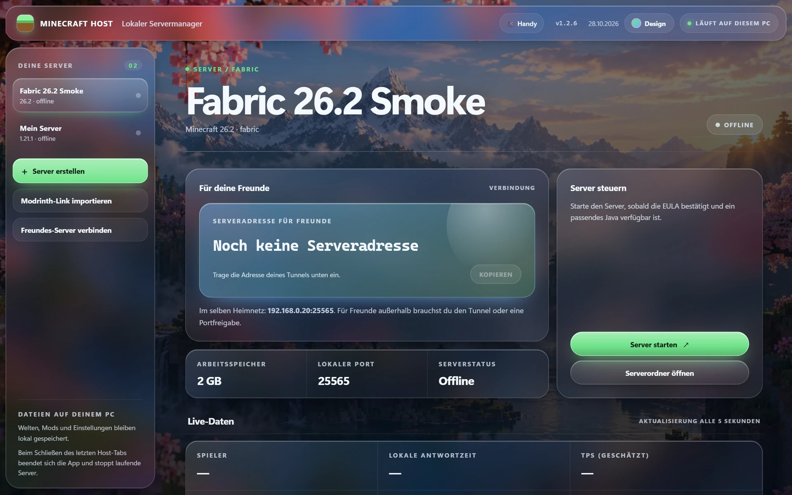
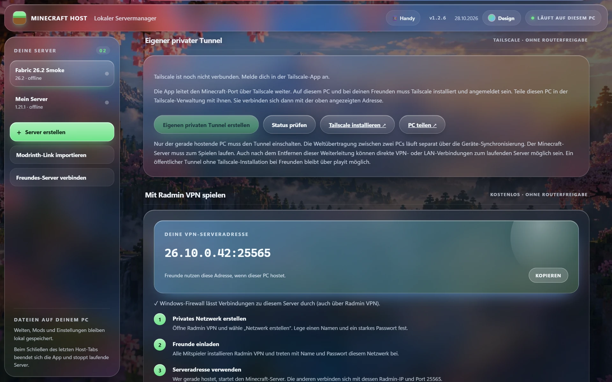

<div align="center">



# Minecraft Host

**Your Minecraft Java server, on your PC. Drop in a modpack, press start, invite your friends.**

[](https://github.com/LvisXVI/minecraft-host/releases/latest)
[](https://github.com/LvisXVI/minecraft-host/releases/latest)
[](app.py)

[🌐 Website](https://lvisxvi.github.io/minecraft-host/) · [⬇️ Download portable](https://github.com/LvisXVI/minecraft-host/releases/latest) · [🧩 Modspire](https://lvisxvi.github.io/modspire/) · [🛠️ Mod Studio](https://lvisxvi.github.io/minecraft-mod-studio/)

</div>

---

Minecraft Host is a local server manager for **Minecraft Java Edition on Windows**. The dashboard opens in your browser on `127.0.0.1`, the server runs on your own PC. It imports Modrinth packs, `.mrpack` files and ready-made server packs, detects Java automatically, and gives you several ways to play with friends – no router configuration required.

> The app interface is currently in German; this documentation is in English.

## ✨ Features

| | |
|---|---|
| 📦 **Modrinth import** | Paste a `modrinth.com/modpack/...` link and pick the pack version. Server-side files are downloaded over HTTPS and verified with SHA1/SHA512; `overrides` and `server-overrides` are applied. |
| 🗂️ **Server packs & `.mrpack`** | Import a `.mrpack`, or unpack a ready-made server pack ZIP (server JAR or Forge/NeoForge start arguments). |
| 🆕 **New servers** | Fabric and Vanilla directly; Forge and NeoForge via the official installer with an exact loader version. |
| ☕ **Java, automatically** | Installed Java 8/17/21/25 runtimes – including the ones from the Modrinth App – are detected. 1.21.x needs Java 21, 26.x needs Java 25. |
| 📈 **Live data** | Player count, local response time, real RAM usage, uptime and, from 1.20.3, mean tick time with estimated TPS. |
| 💻 **Console** | Run `list`, `say Hello` or `whitelist add Name` from the app (without `/`). |
| 🤝 **Host together** | Two PCs, one world: Syncthing transfers the verified world state encrypted, so a friend can take over while your PC is off. |
| 🎨 **Five designs** | Cherry Grove, Aurora, Crystal Valley, Nether and Daylight – a Liquid Glass interface with smooth transitions, switchable in the top bar. |

<p align="center"></p>

## 🚀 Getting started

1. Download the **portable ZIP** from [Releases](https://github.com/LvisXVI/minecraft-host/releases/latest) and unzip it.
2. Run **`MinecraftHost.exe`** – no Python needed. The dashboard opens at `http://127.0.0.1:18765` and is only reachable from this PC.
3. Import a modpack or create a new server, then set RAM, port and Java.
4. Read the [Minecraft EULA](https://www.minecraft.net/eula), accept it in the app, save and start the server.

From source: install Python 3.11+ and run `Start Minecraft Host.cmd`. The app only uses the Python standard library.

## 🌍 Inviting friends

**Recommended: [Radmin VPN](https://www.radmin-vpn.com/) (free, no port forwarding).** Everyone joins the same private Radmin network. Minecraft Host shows the hosting PC's Radmin address with the port and checks whether Windows Firewall lets Java through on the (public) Radmin network.

Other options:

- **Same Wi-Fi:** the LAN address is shown automatically.
- **playit tunnel:** start the bundled, signed [playit agent](https://github.com/playit-cloud/playit-agent/releases) from the app; after linking it, create a Minecraft Java tunnel to your local port.
- **Minekube Connect (Fabric, optional):** "set up for free" adds FabricProxy-Lite to the server and starts the bundled [Gate proxy](https://github.com/minekube/gate). Test a full join with your exact modpack first – some modpacks fail through the proxy with a protocol error; use a direct TCP connection then.
- **Port forwarding:** works too, but Minecraft Host never changes router settings itself.

> For a private group, enable `whitelist on` and add friends with `whitelist add PlayerName`.

## 🤝 Hosting together with a friend

1. Both PCs use the portable package (including `syncthing.exe`) and a matching Java.
2. On the main PC, stop the server → **invite friend** → send the code.
3. Your friend clicks **connect friend's server**, pastes the code and sends back their **device ID**.
4. Confirm the device ID. The verified world state is transferred (both PCs online at the same time once).
5. While the main PC is offline, your friend starts the server; after stopping, the new world state travels back.

The app blocks a start while the other copy reports itself as active or the world state is incomplete. Never start both on purpose. The shared copy does not replace your own backups.

## 🔒 Data & security

- Servers, worlds and configuration: `%LOCALAPPDATA%\MinecraftHost\servers\<server-id>`; app settings in `%LOCALAPPDATA%\MinecraftHost\config.json`.
- The dashboard binds to `127.0.0.1` only and blocks requests from other websites.
- Without Minekube the server runs with `online-mode=true`. With Minekube the backend binds to `127.0.0.1` only and Gate handles account authentication.
- No files from the server folder are uploaded. Proxy keys and the Minekube token stay in `%LOCALAPPDATA%\MinecraftHost\gate`.

## 🛠️ Development & build

```powershell
python app.py                      # dashboard on http://127.0.0.1:18765
pip install pyinstaller
pyinstaller MinecraftHost.spec     # dist\MinecraftHost.exe
```

For the portable package, place `gate.exe`, `playit-agent.exe` and `syncthing.exe` next to the EXE.

## 📚 Technical notes & third-party software

- `.mrpack` handling follows the [Modrinth format specification](https://support.modrinth.com/en/articles/8802351-modrinth-modpack-format-mrpack); NeoForge setup follows the [official server guide](https://docs.neoforged.net/user/docs/server/).
- Bundled in the release, each taken from official releases and checked by SHA256: [playit-agent 0.17.1](https://github.com/playit-cloud/playit-agent/releases/tag/v0.17.1), [Gate 0.75.3](https://github.com/minekube/gate/releases/tag/v0.75.3), [Syncthing](https://github.com/syncthing/syncthing/releases). Their own licences apply.
- Client-only mods or broken pack metadata can still prevent a server from starting. CurseForge client exports don't contain every file – use the creator's **server pack** instead.

Minecraft Host is an independent project and is not affiliated with Mojang or Microsoft.
